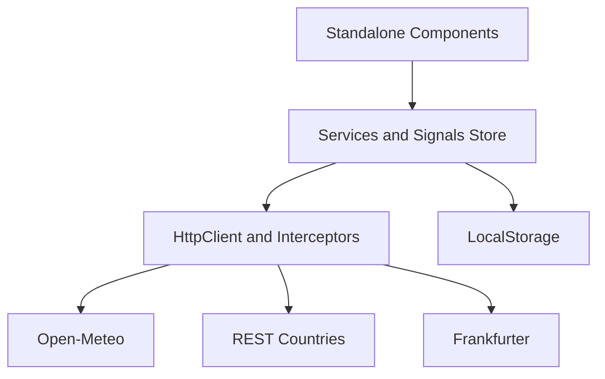

WeatherWise – Travel & Weather Explorer
A responsive Angular application for exploring countries, checking weather forecasts, saving favorite destinations, and converting currencies using public REST APIs. No custom backend or API keys are required for the planned educational MVP.
Project Goals
- Learn Angular from fundamentals to advanced concepts.
- Build a production-style frontend using standalone components, signals, and RxJS.
- Practice API integration, routing, forms, testing, and deployment.
- Create a portfolio-ready application.
Features and Routes
Page	Route	Features	Angular concepts
Dashboard	/	City weather, destination cards	HttpClient, signals, async pipe
Country Explorer	/countries	Search, filter, sort, pagination	Pipes, lists, control flow
Country Detail	/countries/:code	Country information and weather	Route parameters, resolvers, forkJoin, switchMap
Favorites	/favorites	Save and remove destinations	Signals store, LocalStorage
Currency Converter	/converter	Convert currencies	Reactive forms, validation, RxJS
Authentication (optional)	/login, /register	Mock authentication	Guards, interceptors

Technology Stack
- Angular standalone components and TypeScript
- Angular Material and SCSS
- Angular Signals and RxJS
- Angular Router and HttpClient
- Reactive Forms and custom validators
- LocalStorage for client-side persistence
- Vitest for unit tests and Playwright for end-to-end tests
- ESLint, GitHub Actions, Docker, and Vercel
Public APIs
API	Purpose	Documentation
Open-Meteo	Weather forecasts and city geocoding	Documentation
REST Countries	Country information	Documentation
Frankfurter	Currency exchange rates	Documentation

Example requests (verify current API versions and availability before implementation):
GET https://api.open-meteo.com/v1/forecast?latitude=51.5&longitude=-0.12&current=temperature_2m,weather_code
GET https://geocoding-api.open-meteo.com/v1/search?name=London&count=5
GET https://restcountries.com/v3.1/all?fields=name,cca3,flags,region,capital,population
GET https://restcountries.com/v3.1/alpha/JPN
GET https://api.frankfurter.dev/v1/latest?base=USD&symbols=EUR
Check provider usage limits, attribution requirements, and commercial-use terms before deploying. Exchange rates are reference rates, not live trading quotes.
Getting Started
Prerequisites
- Node.js compatible with your Angular version
- npm
- Git
- A code editor such as VS Code
Create the project
npx @angular/cli@latest new weatherwise --routing --style=scss --standalone
cd weatherwise
ng add @angular/material
npm start
Open http://localhost:4200 in your browser.

For an existing Angular project, skip the creation command and integrate the features into your existing source tree.
Common commands
npm install
npm start
npm run build
npm test
After configuring ESLint and Playwright:
ng lint
npx playwright test
Suggested Project Structure
src/
├── app/
│   ├── core/
│   │   ├── guards/
│   │   ├── interceptors/
│   │   ├── models/
│   │   └── services/
│   │       ├── weather.service.ts
│   │       ├── countries.service.ts
│   │       └── currency.service.ts
│   ├── shared/
│   │   ├── components/
│   │   ├── directives/
│   │   ├── pipes/
│   │   └── utils/
│   ├── features/
│   │   ├── dashboard/
│   │   ├── countries/
│   │   ├── country-detail/
│   │   ├── favorites/
│   │   ├── converter/
│   │   └── auth/
│   ├── layout/
│   │   ├── navbar/
│   │   └── footer/
│   ├── store/
│   │   ├── favorites.store.ts
│   │   └── theme.store.ts
│   ├── app.config.ts
│   └── app.routes.ts
├── environments/
└── styles.scss
Architecture

Use lazy-loaded feature routes, typed API models, reusable UI components, and centralized error handling. Use signals for synchronous UI state and RxJS for asynchronous API workflows.
Learning Roadmap
Week 1 — Angular Fundamentals
- [ ] Set up the Angular project and Git repository.
- [ ] Create standalone components and application layout.
- [ ] Configure routing and lazy loading with loadComponent.
- [ ] Practice bindings, signals, @if, and @for.
Week 2 — Country Explorer
- [ ] Create typed models and configure provideHttpClient.
- [ ] Fetch countries using a dedicated service.
- [ ] Implement search, filtering, sorting, and pagination.
- [ ] Add loading, empty, and error states.
Week 3 — Dashboard and Country Details
- [ ] Integrate Open-Meteo weather and geocoding APIs.
- [ ] Build responsive weather cards and forecasts.
- [ ] Implement dynamic route parameters and resolvers.
- [ ] Use switchMap for dependent requests and forkJoin for independent requests.
- [ ] Handle countries without capital coordinates.
Week 4 — State Management
- [ ] Create a favorites store using signal and computed.
- [ ] Add and remove favorite countries.
- [ ] Persist favorites in LocalStorage.
- [ ] Implement light and dark themes.
- [ ] Optionally explore NgRx.
Week 5 — Currency Converter
- [ ] Integrate Frankfurter API and supported currencies.
- [ ] Build a reactive form with amount and currency fields.
- [ ] Add custom validation and same-currency handling.
- [ ] Practice debounceTime, distinctUntilChanged, switchMap, and catchError.
- [ ] Display the exchange-rate date and conversion result.
Week 6 — Advanced Angular
- [ ] Implement functional HTTP interceptors.
- [ ] Add a global loading indicator that handles concurrent requests.
- [ ] Implement bounded retry for transient errors and caching with shareReplay.
- [ ] Add centralized error handling.
- [ ] Optionally implement mock login, register, and route guards.
- [ ] Never attach authentication tokens to unrelated public APIs.
Week 7 — Testing and Quality
- [ ] Test services, components, signals stores, and validators.
- [ ] Mock HTTP requests with Angular HTTP testing utilities.
- [ ] Add Playwright end-to-end tests for core user journeys.
- [ ] Configure ESLint and formatting.
- [ ] Improve keyboard navigation, accessibility, and Lighthouse scores.
Week 8 — Production and Deployment
- [ ] Configure environment settings.
- [ ] Explore SSR and prerendering; guard browser-only LocalStorage access.
- [ ] Add PWA support and an offline fallback.
- [ ] Configure GitHub Actions to build, lint, and test the project.
- [ ] Create a Docker configuration.
- [ ] Deploy to Vercel, Netlify, or Firebase Hosting with appropriate routing configuration.
Acceptance Criteria
- All five core pages work on mobile and desktop.
- Country search, filters, and pagination work correctly.
- Weather data displays units, location, and error states.
- Favorites persist after refreshing the browser.
- Currency conversion validates input and displays the rate date.
- API failures do not crash the application.
- Core user journeys are covered by automated tests.
- The production build completes successfully.
Learning Resources
- Angular documentation
- Angular Material
- RxJS
- Vitest
- Playwright
Project Status
Planned — this README describes the intended implementation, not a completed or tested application. The technology choices and folder structure are suggested defaults and may be adapted to the installed Angular version.

Mock authentication is educational only and does not provide real security. No license has been selected yet.# Weatherwise